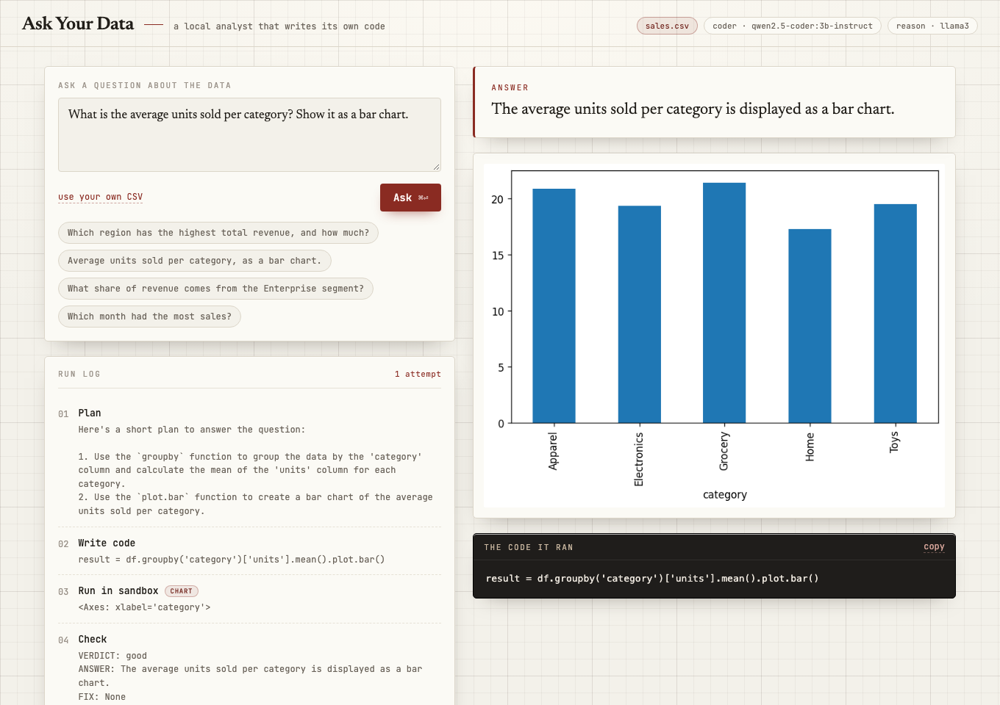

# Ask Your Data

Hand it a CSV and ask a question in plain English. It plans an approach, writes
the pandas code, runs that code in a locked sandbox, checks whether the result
actually answers the question, and fixes its own mistakes before replying. You
get the answer, a chart if one helps, and the exact code it ran.

It's a working analyst, not a chatbot that guesses. Everything runs locally on
open models. No paid APIs.



## How it works

It's a small [LangGraph](https://langchain-ai.github.io/langgraph/) state machine:

```
plan  ->  write code  ->  run in sandbox  ->  check  --(retry)-->  write code
                                               \--(good / give up)--> done
```

- **plan / check** run on a general model (`llama3`).
- **write code** runs on a code model (`qwen2.5-coder:3b-instruct`). Retries warm
  up the temperature so it stops repeating the same mistake.
- **the sandbox** runs the generated code in a separate Python process with a
  time limit, a trimmed set of builtins, and an import allow-list. It can touch
  pandas, numpy, matplotlib and the dataframe, nothing else. This is a guard for
  running on your own data locally, not a hard security boundary.
- Every step is recorded, so the UI can show the agent's actual work.

## Layout

```
backend/
  agent.py      the LangGraph plan -> code -> run -> check loop
  sandbox.py    runs model-written code in a locked-down subprocess
  llm.py        the two local Ollama models
  main.py       the /ask endpoint
  datasets/     a sample sales.csv
  eval/         scores how often the agent gets the answer right
  tests/        pytest suite
frontend/       Vite + React "engineering desk" UI
```

## Running it

You need [Ollama](https://ollama.com) with two models pulled:

```bash
ollama pull qwen2.5-coder:3b-instruct
ollama pull llama3
```

**Backend** (Python 3.10+):

```bash
cd backend
pip install -r requirements.txt
uvicorn main:app --port 8000
```

**Frontend**:

```bash
cd frontend
npm install
npm run dev        # http://localhost:5173
```

Open the page, type a question (or click a suggested one). It uses the bundled
`sales.csv` by default, or upload your own CSV. Add `?demo` to the URL to see a
finished answer without a model running.

## Tests

```bash
cd backend
pytest -q                      # fast: sandbox + validation (no model needed)
AYD_RUN_LLM_TESTS=1 pytest -q  # also runs the live agent tests
```

The fast suite checks the sandbox the most: blocked imports, no `open`, runtime
errors caught not raised, and an infinite loop that gets stopped on the timeout.

## How often is it right?

There's a small eval that computes the true answer from the data with pandas,
runs the agent, and checks whether that answer shows up:

```bash
cd backend
python eval/evaluate.py            # 6 questions on the sample data
python eval/evaluate.py --runs 3   # repeat each, since the models aren't fully deterministic
```

On the built-in question set it scores 6/6 on a clean run. The models aren't
perfectly deterministic, so now and then a question needs the retry loop to land.

## Notes

- Swap models with `AYD_CODER_MODEL` and `AYD_REASON_MODEL` env vars.
- Point it at any CSV. Bigger files just take a little longer to read.
